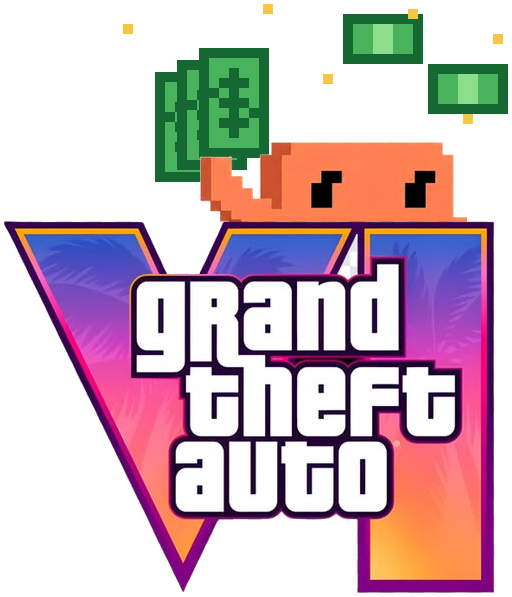

<div align="center">



<h1 align="center">gtavi-claudecode</h1>

<p align="center"><b>Rockstar made the game.<br>Claude Code makes you the money.</b></p>

<p align="center">GTA 6 is about to break the internet. Claude Code watches the biggest streams, catches the second chat explodes and hands you a ready-to-post vertical clip. Campaigns pay per 1,000 views. You just hit post.</p>

<p align="center">   </p>
<p align="center"> </p>
<p align="center"><sub>Unofficial fan project. Not affiliated with Rockstar Games, Take-Two or Anthropic.</sub></p>
<p align="center"><a href="#first-run-paste-this-into-claude-code">Quick start</a> · <a href="#two-ways-to-make-money">Make money</a> · <a href="#whats-inside">Skills</a> · <a href="#the-rules-that-make-clips-win">Clip rules</a> · <a href="#run-the-scripts-yourself">Scripts</a></p>

</div>

```
/plugin marketplace add DragosBaci/gtavi-claudecode
/plugin install gtavi-claudecode@gtavi-claudecode
```

Two lines in Claude Code. In 10 minutes you have: the tools installed, your page folder, today's trending GTA 6 videos, the best moments picked and your first vertical clips ready to post.

## First run: paste this into Claude Code

Open Claude Code in an empty folder: that folder becomes your clip desk (clips, queue and tools all live there). Then:

```
/gtavi-claudecode:desk-tour
```

It installs everything, starts the Clip Desk in your browser and walks you through it page by page while you make your first clip. Or, to do it all from the terminal:

```
Use gtavi-claudecode. Set up my GTA 6 clip page, ask me your 4 questions in one message,
then do everything after one "yes": find live clipping campaigns, show today's trending
GTA 6 videos and live streams, find the best moments in the top one, cut my first 3 clips
with hooks, check them against the campaign rules, and tell me what to post where.
```

## Two ways to make money

**1. Paid clipping campaigns (fastest).** Streamers and brands pay clippers per 1,000 views on approved clips. On Whop Content Rewards around $1 per 1K views is common; every campaign shows its own rate, budget left and rules. `campaign-finder` reads them live and never guesses a number. You read the rules, clip only that creator, post, submit the link.

**2. Your own faceless GTA 6 page (bigger, slower).** The built-in playbook runs it: daily content mix, credit rules, caption templates, the launch-day "be first" plan and a learning loop. Platforms don't pay for reposted clips, so the page grows on speed, useful tips and credited clips, then earns through campaigns and partnerships.

No income is promised. Your result depends on speed, picks and hooks, and the scoreboard shows what works.

## The rules that make clips win

- Hook in the first second. Say why to keep watching ("the hidden car nobody found").
- 7 to 30 seconds. Cut dead air at the start, end on the payoff.
- Big captions in the safe area. Most people watch muted.
- Make it yours: hook, tip, commentary. Never a plain re-upload. Credit the creator in your post.
- Launch day (Nov 19): players in New Zealand and Australia unlock first. Clip their streams, post to X first, then Reels, TikTok and Shorts, every 1 to 2 hours for 48 hours.
- Every repeated question in your comments becomes a HOW TO post.
- One test per day. No verdict before 24 hours, prefer the 72 h numbers.

## What's inside

| Skill | What you get |
|---|---|
| `setup` | Installs ffmpeg, yt-dlp and faster-whisper, asks 4 questions, builds your page folder |
| `desk-tour` | Sets up and starts the Clip Desk (http://127.0.0.1:8766), then walks you through Make, Editor, Post and Live while you make your first clip |
| `campaign-finder` | Live campaigns: rate per 1K views, budget left, rules, link |
| `campaign-submit` | Submits posted clip links to the paid campaigns they qualify for, in Chrome, signed in as you. Runs after posting and from the Campaigns page |
| `trend-radar` | GTA 6 videos from the last 24 h ranked by views per hour |
| `stream-finder` | Who is streaming GTA 6 right now, ranked by viewers |
| `moment-finder` | Best 15 to 40 s moments, scored by loudness spikes, hype words, YouTube "most replayed" and chat spikes |
| `live-mode` | Records a live stream and cuts a clip every time chat explodes |
| `twitch-reaction` | Reaction clips like the viral ones: the streamer's face on top, the game below, a big title on the seam. Finds the top GTA 6 Twitch streams with no account, reads chat and finds the webcam by itself |
| `clip-cutter` | 1080x1920 clip: word-by-word captions, hook box, two-pass -14 LUFS. Split (face on top), Focus (big window that follows the face or the action), Fill, Fit |
| `hook-writer` | 3 hook options per clip |
| `rule-check` | Length, format, hashtags and banned content checked before you post |
| `multilang` | One clip in 5 languages: translated word-by-word captions and hook in ES, PT, DE, RU, optional stock-voice hook. Non-English GTA pages are almost empty |
| `questions-to-posts` | Pulls repeated questions from GTA subreddits and your comments, turns the answered ones into HOW TO posts |
| `secrets-map` | Builds a database of hidden spots, money, cars and collectibles from clips, with timestamp and credit. Verified ones become evergreen tip posts |
| `cheat-codes` | All reported GTA 6 cheat codes with unlock tasks and sources, turned into a 4-slide cheat carousel |
| `playbook` | Your full daily routine and launch-day plan |
| `learning-loop` | Scoreboard, one test per day, payouts from real numbers only |
| `upload-next` | Posts the best queued clip to YouTube Shorts, TikTok and Instagram Reels through Claude in Chrome: chooses the best one, uploads, records the links. Run it on a timer: `/loop 2h /gtavi-claudecode:upload-next` |

Nothing is posted unless you press **Post now** on the Post page or start `upload-next`. Claude only posts as the account you set in **Posting as**, never types a password and never solves a CAPTCHA.

## Hard rules

No leaks, no "play early" or "free download" posts, no piracy, no GTA Online money or AFK bots, no fake news, never pretends to be Rockstar. Every fact needs an official source.

## Run the scripts yourself

```
pip install -r requirements.txt
python scripts/trends.py --query "gta 6" --hours 24
python scripts/streams.py --query "gta 6"
python scripts/moments.py "https://www.youtube.com/watch?v=..." --top 8
python scripts/cut.py jobs/<id> --pick 2 --layout facecam --hook "Nobody noticed this"
python scripts/check.py jobs/<id>/edits/clip_2.mp4 --campaign campaigns.md
python scripts/live.py "https://www.youtube.com/watch?v=<live>" --minutes 60
python scripts/watch.py https://twitch.tv/<a> https://twitch.tv/<b> --minutes 120   # several streams, clips when chat explodes
python scripts/editor.py        # then open http://127.0.0.1:8766 (Clip Desk: Make, Post, Live, and the editor)
python scripts/uploader.py status                     # the posting queue (data in queue/ of your desk folder)
python scripts/uploader.py account --name "My Page" --handle mypage   # the only account Claude may post as
python scripts/stats.py                               # real views/likes of every post -> scoreboard.csv (feeds the pickers)
python scripts/campaigns.py list                      # paid campaigns; `earnings`, `match <job>/<clip>`, `parse <id>`
python scripts/frames.py jobs/<id>                    # frame strips of the picks (or --clip <name>) for a visual check
python scripts/post_now.py <job>/<clip>               # Claude posts this clip now, in Chrome
```

The editor UI is a Next.js app in `web/` (React, TypeScript). Build it once and `editor.py` serves it:

```
cd web && npm install && npm run build      # static export in web/out, served by editor.py
npm run dev                                  # development: http://localhost:3000, proxies /api, /media, /fonts to editor.py
```

### Clip Desk

`scripts/editor.py` serves the whole desk in the browser (run it from the folder that holds `jobs/`). Four pages: **Make · Post · Campaigns · Live**; the editor opens from any clip.

- **Make** (`/`): paste YouTube links or pick from the trending GTA 6 videos (or let Claude choose them) and press **Start**. Everything after that runs by itself: `pipeline.py` transcribes, Claude (`claude -p`, Opus by default: `CLAUDE_MODEL_PICK`) reads each transcript the way `moment-finder` says and picks moments, looks at 8 frames of each and keeps only the ones it would bet on, `cut.py` renders the keeps (Split when the streamer's webcam is over gameplay, otherwise Focus), Claude checks each finished clip's frames, and the ones that pass go straight into the posting queue. **Moments** below lists the picks that aren't clips yet (the *maybes*) with Claude's verdict; render one by hand if you want it too.
- **Post** (`/queue`): the posting queue. Set **Posting as** first. Select a clip to watch it, edit its text per platform (saved to `queue/overrides.json`, which the auto-uploader uses too), **🚀 Post now** (Claude posts it on YouTube, TikTok and Instagram in Chrome), or **Remove** it. X is posted by hand: its tab has **Copy**, **Mark as posted** and the post link. The auto-uploader (`upload-next`) decides the order when it posts.

### Campaigns (paid campaigns)

`/campaigns` gives every paid campaign its own category (the ones paying on YouTube first): what it pays for, the clips made for it or of its creators waiting in the queue, and the posted ones with their views and submission status. `campaign-finder` keeps `campaigns.json` current (rate per 1K views, budget, creators, platforms). A Make run can be made **for a campaign** (any live one): Claude picks by its rules and every clip is filed under it, on the Post page too (campaign filter). Join a campaign on its own page, then under **Set up** press **I joined it**, paste its rules (Claude turns them into settings: length, required overlay and where, caption text, hashtags, payout limits) and add its overlay PNG. From then on:

- every new clip of that campaign's creators is rendered with its overlay and the required caption text (`cut.py --overlay`, `campaigns.py`), and a Make run can be made **for a campaign** (that creator's latest videos, picked by its rules);
- the Post page marks qualifying clips **$** and they go out first; a clip that breaks a rule says why (too long, made without the overlay);
- when a clip goes live, its link is queued to submit, and Claude submits it in Chrome right after posting, or with **Submit with Claude** (`submit_now.py`, skill `campaign-submit`). It never joins a campaign, accepts terms, signs in or opens payout settings;
- once a campaign is joined, the page shows submissions and their status, real views (`scoreboard.csv`), an estimate of what they're worth (rate × views, fee and per-post limits applied) and the payouts in `payouts.csv`.

### Clip editor

`/edit` fixes a clip:

- **Transcript**: drag across words, then Cut (Delete), Set as hook (H) or Keep silent (K) for a silent visual moment. **[** / **]** set the start and end, ⌘Z undoes.
- **Live 9:16 preview** of the layout, title and captions, drawn from the source video without rendering. *Edit preview* plays the hook, the zoom into the clip, then the clip with your cuts and the pauses trimmed the way the render trims them.
- **Side panel**: *Title*, *Layout* (Split, Focus, Fill, Fit; drag the webcam box when auto-detect picked the wrong face), *Trim and hook*. The look (word captions, white title box, zoom into the clip, pause trimming, punch-in) is the same on every clip.
- **Timeline**: thumbnails, the clip window and hook with draggable edges, cuts, kept parts and trimmed pauses. Shift-drag selects a range. ⌘Z undoes.
- **Render** (bottom bar, with progress and the last error) runs `cut.py` with these settings; the finished clip joins the posting queue and the Post page opens on it.

Every render saves its options in the clip's `.json`, so the editor reopens a clip exactly as it was made.

### Live page

`http://127.0.0.1:8766/live` runs `watch.py` from the browser:

- **Pick streams**: the top GTA 6 streams on Twitch with thumbnails, or paste Twitch / YouTube live URLs (up to 9). It watches for 2 hours (**＋1 h** extends) and clips at 3× the usual chat.
- **Split screen**: every stream plays side by side from the recording itself, with its live chat level over the last 3 minutes (the dashed line is the clip threshold). Click 🔇 to listen to one.
- **Clips**: a clip is cut automatically when a chat explodes: 3× the usual number of *different people* chatting, held for 3+ seconds, at most 3 clips per stream per 10 minutes unless a bigger moment comes (the tile flashes), or press **Clip now** (keys 1–9) to clip what you just saw. Each clip lands in the feed on the right with an **Edit** link that opens it in the editor with the moment as its hook.
- **Add stream**, **+1 h** and **Stop** work while it runs. Streams that drop reconnect by themselves. A `watch.py` started from the terminal shows up here too.

Windows, macOS or Linux, Python 3.10+. An NVIDIA GPU makes transcription faster; on the CPU a 12-minute video takes about 5 minutes.

MIT license.
